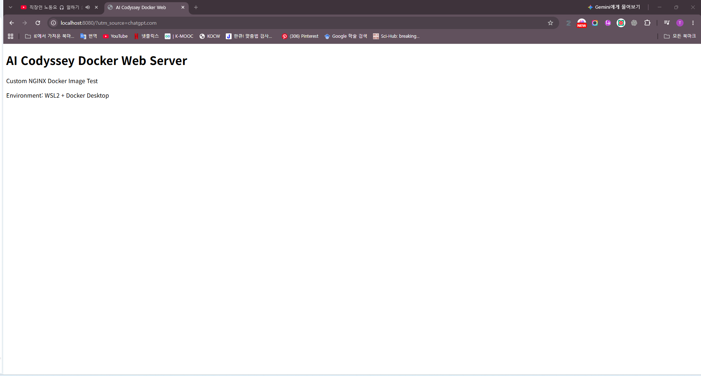

# AI Codyssey - 개발 워크스테이션 구축

## 1. 프로젝트 개요

Linux CLI, Docker, Git/GitHub를 활용하여 재현 가능한
개발환경을 구축하고, 컨테이너 기반 웹 서버를 실행·검증한다.

주요 학습 목표:
- Linux 터미널 및 파일 권한 이해
- Docker 이미지와 컨테이너 관리
- Dockerfile 기반 커스텀 이미지 제작
- 포트 매핑 및 HTTP 통신 검증
- 바인드 마운트와 볼륨 영속성 검증
- Git/GitHub 기반 버전 관리

## 2. 개발 환경

| 항목 | 환경 |
|---|---|
| 호스트 환경 | Windows + WSL2 |
| Linux | Ubuntu 26.04.1 LTS |
| Shell | Bash |
| 개발 도구 | Visual Studio Code |
| Docker Client/Server | 29.7.2 |
| Docker Compose | v5.5.0 |
| Git | 2.53.0 |
| 기본 브랜치 | main |

## 3. 필수 수행 체크리스트

- [x] Linux CLI 기본 명령 실습
- [x] 파일 및 디렉터리 권한 변경
- [x] Docker 설치 및 엔진 동작 검증
- [x] hello-world 컨테이너 실행
- [x] Ubuntu 컨테이너 내부 명령 실행
- [x] Docker 이미지 및 컨테이너 운영
- [x] Dockerfile 기반 커스텀 이미지 빌드
- [x] NGINX 웹 서버 실행
- [x] 포트 매핑 및 HTTP 접속 검증
- [x] 바인드 마운트 변경 반영 검증
- [x] Docker 볼륨 영속성 검증
- [x] Git 사용자 및 기본 브랜치 설정
- [x] GitHub 원격 저장소 설정
- [ ] VS Code GitHub 로그인 화면 증거 확보
- [ ] 최종 GitHub Push 및 제출 확인

## 4. Linux CLI 및 파일 권한

pwd, ls, cd, mkdir, touch, cat, cp, mv, rm 명령을
활용하여 파일과 디렉터리를 조작했다.

절대경로는 루트(/)부터 표시하는 전체 경로이고,
상대경로는 현재 작업 디렉터리를 기준으로 한다.

파일 권한:
- 644: 소유자 읽기/쓰기, 나머지 읽기
- 755: 소유자 읽기/쓰기/실행, 나머지 읽기/실행
- 700: 소유자만 읽기/쓰기/실행

권한 숫자는 r=4, w=2, x=1을 합산한다.

실습 기록:
- [Linux CLI 실습](logs/01-linux-cli.md)
- [Linux CLI 실행 및 권한 변경 증거](logs/01-linux-cli-evidence.txt)

## 5. Docker 기본 운영

Docker Client와 Server 29.7.2의 정상 동작을 확인했다.

hello-world 컨테이너의 성공 메시지를 확인했고,
Ubuntu 24.04 컨테이너 내부에서 명령을 실행했다.

이미지는 컨테이너 실행을 위한 템플릿이며,
컨테이너는 이미지로부터 생성된 실행 인스턴스이다.

주요 명령:
- docker --version
- docker info
- docker images
- docker ps -a
- docker logs
- docker stats

실습 증거:
[Docker 기본 운영 로그](logs/02-docker-basics.txt)

## 6. 커스텀 Docker 이미지 및 웹 서버

NGINX Alpine 이미지를 기반으로 HTML 콘텐츠를
교체하는 커스텀 Dockerfile을 직접 작성했다.

커스텀 포인트:
- LABEL: 이미지 식별 정보 설정
- COPY: 커스텀 HTML 콘텐츠 적용
- EXPOSE: 웹 서버 포트 80 명시

이미지 빌드:

```bash
docker build -t ia-codyssey-web:1.0 .
```

컨테이너 실행:

```bash
docker run -d --name codyssey-web \
  -p 8080:80 ia-codyssey-web:1.0
```

HTTP 검증:

```bash
curl -i http://localhost:8080
```

실제 HTTP 200 OK 응답과 커스텀 HTML을 확인했다.

- [웹 서버 검증 로그](logs/03-docker-web.txt)
- [브라우저 접속 스크린샷](evidence/web-8080.png)



## 7. 바인드 마운트 검증

호스트의 app 디렉터리를 NGINX 웹 디렉터리에
읽기 전용 바인드 마운트로 연결했다.

```bash
docker run -d --name codyssey-bind \
  -p 8081:80 \
  --mount type=bind,source="$(pwd)/app",target=/usr/share/nginx/html,readonly \
  ia-codyssey-web:1.0
```

호스트의 app/index.html 파일을 수정한 뒤 비교했다.

- localhost:8080: 기존 이미지 HTML 유지
- localhost:8081: 수정한 HTML 즉시 반영

이는 이미지 재빌드 없이 호스트 파일 변경이
컨테이너에 반영됨을 증명한다.

[바인드 마운트 검증 로그](logs/04-bind-mount.txt)

## 8. Docker 볼륨 영속성

Docker 볼륨을 생성하고 첫 번째 컨테이너에 연결했다.

```bash
docker volume create codyssey-data

docker run -d --name codyssey-volume-1 \
  -v codyssey-data:/data ubuntu:24.04 sleep infinity

docker exec codyssey-volume-1 \
  sh -c 'echo "AI Codyssey Persistent Data" > /data/hello.txt'

docker exec codyssey-volume-1 cat /data/hello.txt
```

첫 번째 컨테이너를 삭제했다.

```bash
docker rm -f codyssey-volume-1
```

두 번째 컨테이너에서 같은 볼륨을 연결했다.

```bash
docker run -d --name codyssey-volume-2 \
  -v codyssey-data:/data ubuntu:24.04 sleep infinity

docker exec codyssey-volume-2 cat /data/hello.txt
```

검증 결과:

```text
AI Codyssey Persistent Data
```

컨테이너를 삭제해도 볼륨의 데이터가
유지된다는 사실을 확인했다.

[볼륨 영속성 검증 로그](logs/05-docker-volume.txt)

## 9. Git 및 GitHub

Git 사용자 설정과 기본 브랜치 main을 확인했다.

Git은 로컬 버전 관리 시스템이며,
GitHub는 원격 저장소 및 협업 플랫폼이다.

[Git 설정 증거](logs/06-git-setup.txt)

원격 저장소:
https://github.com/lkh1315/ia-codyssey

## 10. 트러블슈팅

### 사례 1. WSL에서 Docker 명령 실행 불가

**문제**

WSL Ubuntu 터미널에서 docker 명령을 찾지 못했다.

**원인 가설**

Docker Desktop의 WSL Integration 설정 문제.

**확인**

docker --version 및 docker info 실행 시
Docker 명령을 찾을 수 없다는 메시지를 확인했다.

**해결 및 검증**

Docker Desktop과 WSL 연동 설정을 조정한 후
Docker Client 및 Server 버전 출력과
컨테이너 동작을 정상적으로 확인했다.

### 사례 2. 터미널 프롬프트 입력 오류

**문제**

터미널 프롬프트를 명령어로 입력하여
No such file or directory 오류가 발생했다.

**원인**

user@DESKTOP...$ 문자열은 실행 명령이 아니라
현재 사용자와 경로를 보여주는 프롬프트였다.

**확인**

Bash에서 해당 문자열을 명령으로 해석하려다
오류가 발생한 것을 확인했다.

**해결 및 검증**

프롬프트 부분을 제외하고 실제 명령어만 실행했다.
이후 프로젝트 경로 확인과 Docker/Git 명령 실행에 성공했다.

## 11. 재현 방법

저장소 복제:

```bash
git clone https://github.com/lkh1315/ia-codyssey.git
cd ia-codyssey
```

Docker Desktop 및 WSL 연동이 정상적으로
설정되어 있어야 한다.

이미지 빌드 및 실행:

```bash
docker build -t ia-codyssey-web:1.0 .
docker run -d --name codyssey-web \
  -p 8080:80 ia-codyssey-web:1.0
curl http://localhost:8080
```

기존에 codyssey-web 컨테이너가 존재하는 경우
이름 충돌이 발생할 수 있으므로 기존 상태를 확인한다.

로컬 프로젝트 절대경로는 사용자마다 다르므로
마운트할 때 "$(pwd)/app" 경로를 사용한다.

## 12. 증거 자료

| 항목 | 증거 |
|---|---|
| Linux CLI | [실습 기록](logs/01-linux-cli.md) |
| 권한 변경 | [검증 로그](logs/01-linux-cli-evidence.txt) |
| Docker 기본 운영 | [검증 로그](logs/02-docker-basics.txt) |
| Docker 웹 서버 | [검증 로그](logs/03-docker-web.txt) |
| 바인드 마운트 | [검증 로그](logs/04-bind-mount.txt) |
| Docker 볼륨 | [검증 로그](logs/05-docker-volume.txt) |
| Git 설정 | [검증 로그](logs/06-git-setup.txt) |
| 브라우저 접속 | [스크린샷](evidence/web-8080.png) |
